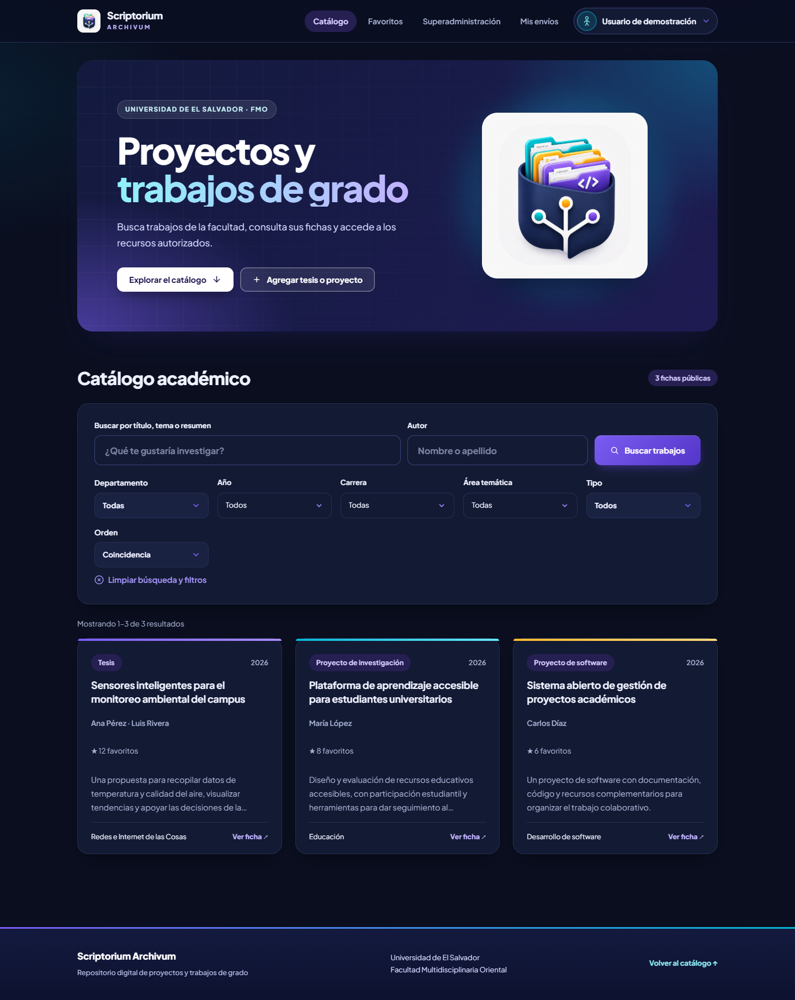
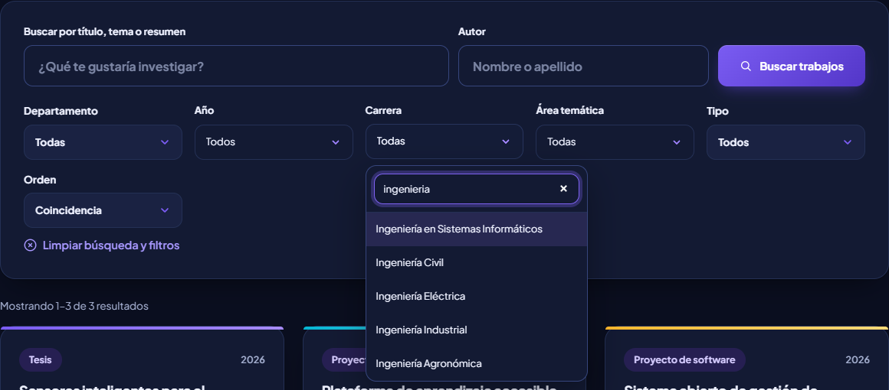
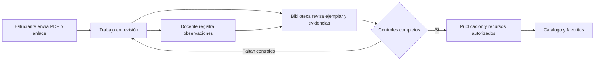
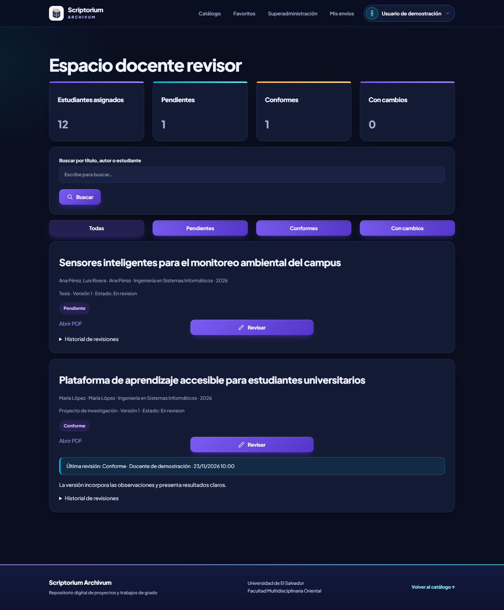
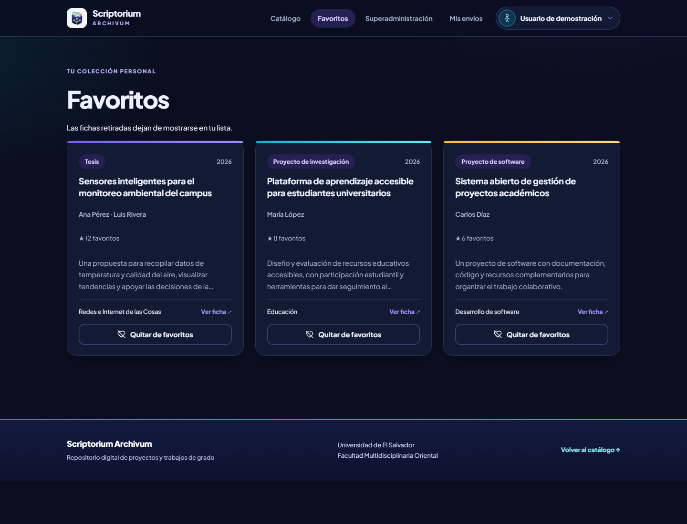
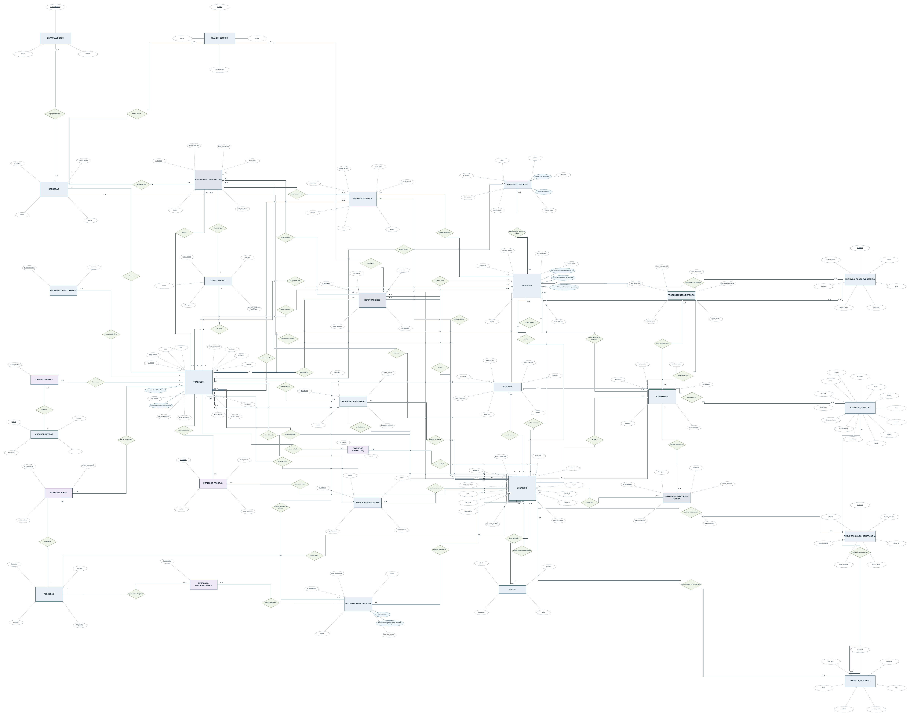
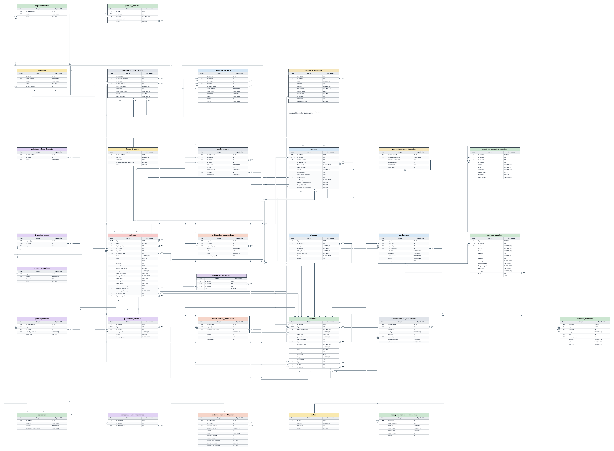

<p align="center"></p>

# Scriptorium Archivum

Repositorio digital de proyectos y trabajos de grado de la **Universidad de El Salvador · Facultad Multidisciplinaria Oriental**. Reúne consulta pública, recepción de trabajos, revisión docente y publicación controlada por Biblioteca.

**Versión del código: 26 de noviembre de 2026.** Angular + ASP.NET Core + PostgreSQL. Incluye la rama `frontend-benjamin-daniel`, las mejoras de la aplicación y la integración verificada el 23 de noviembre. Consulta el [registro de actualización de `main`](docs/PUBLICACION-20261124.md). Actualizar el repositorio no actualiza automáticamente una instalación que esté apagada.



> Todas las capturas utilizan cuentas, nombres y trabajos ficticios de demostración.

## Funciones

- Búsqueda por título, tema, resumen y nombre o apellido del autor.
- Filtros por departamento, carrera, área temática, año y tipo. Carrera, Área temática y Año tienen búsqueda interna y hasta cinco opciones visibles antes de desplazarse.
- Fichas, lectura del PDF autorizado, apertura en otra pestaña y descarga de recursos permitidos.
- Favoritos por cuenta. Las estrellas representan **veces guardado en favoritos**, no calificaciones.
- Envíos PDF de hasta **6 GB**, con transferencia por partes para archivos grandes. El tipo **Proyecto de software** se recibe mediante un enlace HTTPS.
- Complementos Word, Excel, PowerPoint, ZIP/RAR, código y otros archivos. Se descargan en su formato original; el visor principal corresponde al PDF.
- Docente asignado y correo, observaciones recibidas e historial por versión.
- Envío de una [versión corregida](docs/VERSIONES-CORREGIDAS-20261126.md) cuando hay cambios solicitados, decisión desfavorable o constancia revocada; conserva el original y vuelve a revisión.
- Administración de cuentas, roles, habilitación, asignaciones y datos académicos.
- Recuperación de contraseña por correo, opción de mostrarla y compatibilidad con el gestor del navegador.
- Actualización automática de listas, estados, favoritos y asignaciones, conservando los campos todavía no guardados.
- Lista de fichas de Biblioteca con desplazamiento interno y filtro visible.
- Copia institucional de los eventos registrados en bitácora, con responsable, motivo y destinatarios. Consulta la [configuración y validación](docs/COPIAS-INTERNAS-20261125.md).
- Modo claro u oscuro, adaptación a móvil, iconos originales y transiciones que se pueden omitir y respetan la preferencia de reducir movimiento.
- Navegación compacta con botón Menú en móvil y tableta; tarjetas de roles con iconos y títulos separados. [Validación del diseño](docs/MOVIL-20261125.md).

## Búsqueda dentro de los desplegables

Escribe `ingeniería` dentro de Carrera. Al completar `ingeniería en sistemas`, la lista se reduce a la carrera coincidente. La búsqueda no distingue entre letras con o sin tilde.



## Espacios y permisos

| Rol | Funciones principales |
| --- | --- |
| Lector | Consultar catálogo y recursos autorizados, guardar favoritos y gestionar su perfil. |
| Estudiante | Enviar trabajos, consultar su docente, adjuntar complementos y revisar observaciones. |
| Docente revisor | Revisar trabajos de estudiantes asignados y registrar **Conforme** o **Requiere cambios**, con historial por versión. |
| Biblioteca | Corregir metadatos, verificar ejemplar y evidencias, gestionar autorizaciones, publicar y retirar fichas. |
| Administrador | Gestionar cuentas, roles permitidos, habilitación, perfiles, asignaciones y actividad reciente. |
| Superadministrador | Acceder a todos los espacios y gestionar también las cuentas con privilegios superiores. |

Los permisos se comprueban en la API. Ocultar un botón no sustituye esa comprobación.


## Del envío a la publicación



La revisión docente **no publica automáticamente** un trabajo. La decisión de Biblioteca y los permisos corresponden al ejemplar verificado. Al cambiar de versión se exige revisar el nuevo ejemplar y se mantienen las observaciones anteriores.

Los proyectos de software se registran sin PDF cuando su tipo es Proyecto de software. Biblioteca conserva el control sobre la publicación de la ficha y la habilitación del enlace externo.


### Panel docente

Incluye resumen, búsqueda, filtros, apertura del recurso y observaciones de entre 10 y 5000 caracteres. Una reasignación o cambio de ejemplar se vuelve a comprobar antes de guardar.



### Favoritos y móvil

Las tarjetas mantienen la presentación del catálogo y permiten abrir la ficha o quitarla de la colección personal.



<p align="center"></p>

## Diagramas de Roberto

Diagramas de datos elaborados por **Roberto**. Las imágenes permiten consultar el diseño desde el README; al pulsarlas puedes abrir el PDF completo para ampliar los detalles.

### Diagrama entidad-relación (DER)

[](backend/documentacion/DER%20revisado%20-%20Scriptorium_archivum.pdf)

[Abrir PDF del DER](backend/documentacion/DER%20revisado%20-%20Scriptorium_archivum.pdf) · [Archivo editable de Draw.io](backend/documentacion/DER%20actualizado%20-%20Scriptorium_archivum.drawio)

### Modelo relacional

[](backend/documentacion/Modelo%20relacional%20corregido%20-%20Scriptorium_archivum.pdf)

[Abrir PDF del modelo relacional](backend/documentacion/Modelo%20relacional%20corregido%20-%20Scriptorium_archivum.pdf) · [Archivo editable de Draw.io](backend/documentacion/Modelo%20relacional%20actualizado%20-%20Scriptorium_archivum.drawio)

También está disponible el [diccionario de datos de Roberto](backend/documentacion/Diccionario%20de%20datos%20actualizado%20-%20Scriptorium_archivum.pdf).

Se conservan sus documentos originales del modelo base. Las ampliaciones posteriores del esquema están registradas en las [migraciones de la base de datos](backend/sql-init).

## Ejecutar en desarrollo

Necesitas Git, Docker Desktop y Node.js compatible con `frontend/package.json`. La guía de base de datos, API, correo de prueba y usuarios ficticios está en [backend/README.md](backend/README.md).

1. Copia `backend/.env.example` como `backend/.env` y define contraseñas **locales**. Conserva el correo de desarrollo en Mailpit.
2. Desde `backend/`, inicia los servicios:

   ```powershell
   docker compose -p scriptorium-integracion up -d --build
   ```

3. Desde `frontend/`, instala e inicia la interfaz:

   ```powershell
   npm ci
   npm start -- --configuration integration --host 127.0.0.1 --port 4301
   ```

4. Abre [la aplicación local](http://127.0.0.1:4301/). Su proxy envía las solicitudes `/api` a la API local.

Las migraciones de `backend/sql-init/` se ejecutan al crear una base vacía. Una base existente requiere revisar y aplicar las pendientes con un respaldo previo; reiniciar contenedores no ejecuta por sí solo los archivos nuevos. La integración docente conserva el historial anterior mediante `19_integracion_repositorio.sql`.

## Estructura

```text
frontend/
  src/app/core/       API, sesión, actualizaciones y transiciones
  src/app/pages/      Catálogo, favoritos, envíos y paneles por rol
  src/app/shared/     Selectores, archivos, revisiones e iconos
backend/
  APIScriptoriumArchivum/  API, permisos y publicación
  sql-init/                Esquema y migraciones
  pruebas/                 Guías y colección de Postman
  integracion/             Contrato de integración de la API
docs/
  imagenes/          Capturas con datos ficticios
  pruebas/           Evidencia de verificación local
```

## Pruebas y requisitos

La compilación y las pruebas automatizadas se documentan en [el informe de verificación](docs/PRUEBAS-20261123.md). El [contraste con los requisitos](docs/REVISION-REQUISITOS-20261123.md) distingue funcionalidad, ampliaciones solicitadas y criterios que requieren observación o participantes externos.

Un resultado local no acredita por sí solo disponibilidad de una instalación real ni usabilidad con estudiantes. Los requisitos diferidos conservan ese estado hasta ampliar formalmente su alcance.

## Configuración y datos privados

Se comparten código, migraciones, ejemplos de configuración sin secretos y documentación. Los `.env` reales, credenciales SMTP, copias de la base, documentos de usuarios, fotos y claves de sesiones se conservan fuera del repositorio. No se publica la configuración privada de una instalación.
