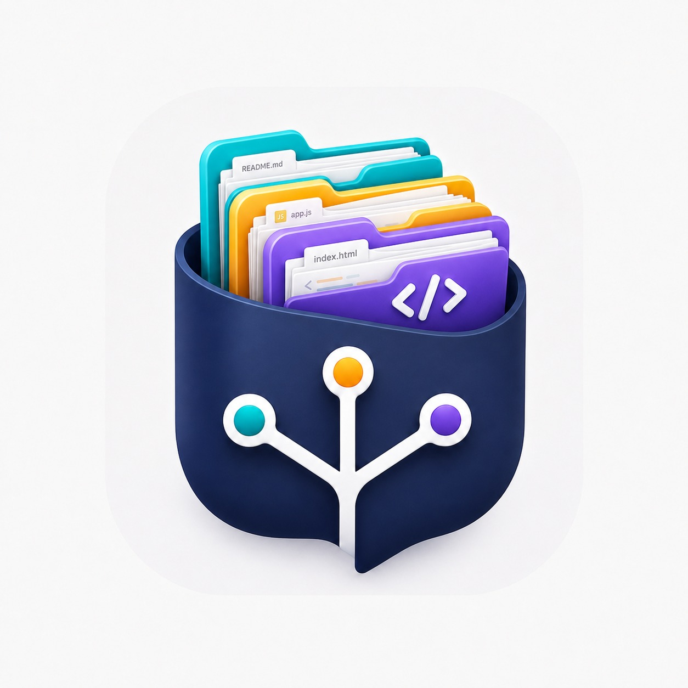
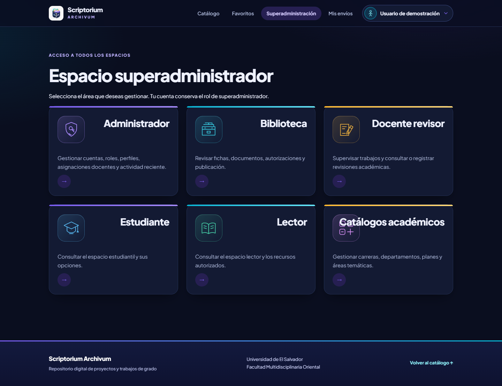
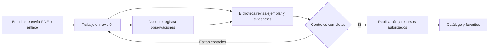
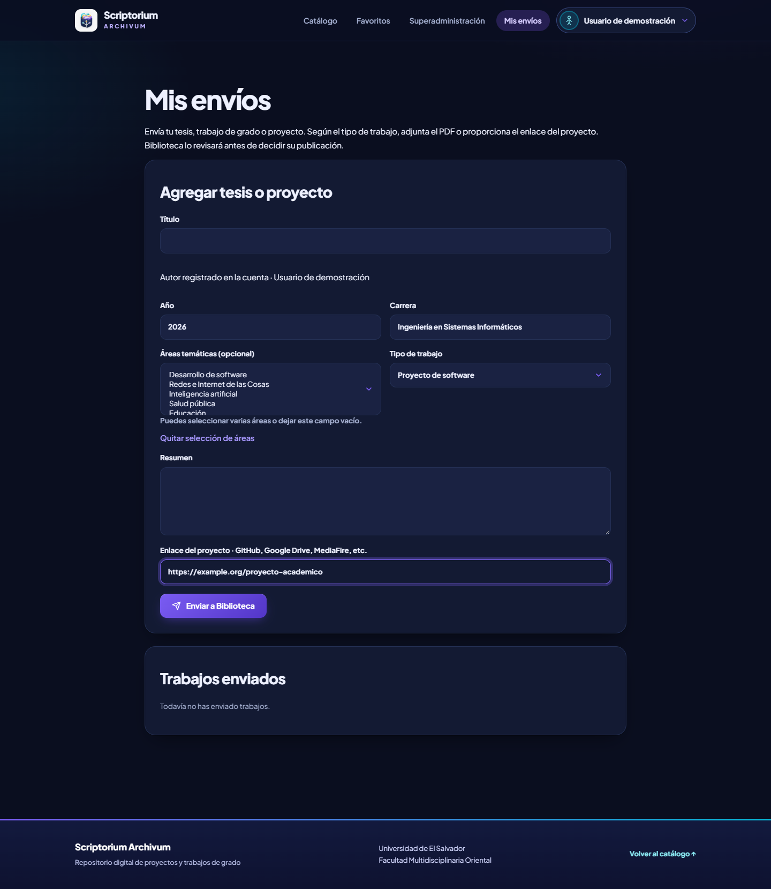
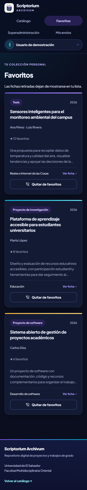
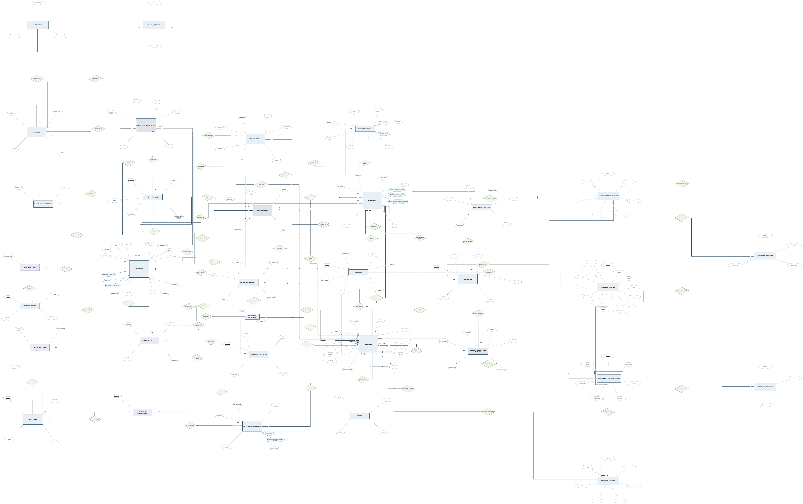
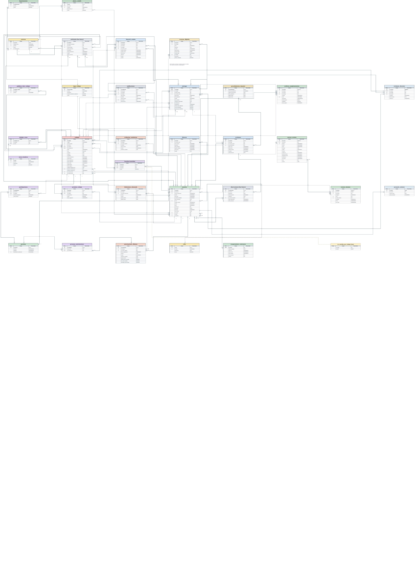

<p align="center"></p>

# Scriptorium Archivum

Repositorio digital de proyectos y trabajos de grado de la **Universidad de El Salvador · Facultad Multidisciplinaria Oriental**. Reúne consulta pública, recepción de trabajos, revisión docente y publicación controlada por Biblioteca.

La interfaz utiliza Angular y se conecta a una API ASP.NET Core con Entity Framework Core y PostgreSQL. PostgreSQL y pgAdmin se ejecutan con Docker Compose; la API se inicia desde Visual Studio o con la terminal de .NET.


> Todas las capturas utilizan cuentas, nombres y trabajos ficticios de demostración.

## Funciones

- Búsqueda por título, tema, resumen y nombre o apellido del autor.
- Filtros por departamento, carrera, área temática, año y tipo. Carrera, Área temática y Año tienen búsqueda interna y hasta cinco opciones visibles antes de desplazarse.
- Fichas, lectura del PDF autorizado, apertura en otra pestaña y descarga de recursos permitidos.
- Favoritos por cuenta. Las estrellas representan **veces guardado en favoritos**, no calificaciones.
- Envíos PDF de hasta **6 GB**, con transferencia por partes para archivos grandes. El tipo **Proyecto de software** se recibe mediante un enlace HTTPS.
- Complementos Word, Excel, PowerPoint, ZIP/RAR, código y otros archivos. Se descargan en su formato original; el visor principal corresponde al PDF.
- Docente asignado y correo, observaciones recibidas e historial por versión.
- Envío de una [versión corregida](docs/VERSIONES-CORREGIDAS-20261126.md) cuando hay cambios solicitados, decisión desfavorable o constancia revocada; conserva el original y vuelve a revisión.
- Administración de cuentas, roles, habilitación, asignaciones y datos académicos.
- Recuperación de contraseña por correo, opción de mostrarla y compatibilidad con el gestor del navegador.
- Actualización automática de listas, estados, favoritos y asignaciones, conservando los campos todavía no guardados.
- Lista de fichas de Biblioteca con desplazamiento interno y filtro visible.
- Copia institucional de los eventos registrados en bitácora, con responsable, motivo y destinatarios. Consulta la [configuración y validación](docs/COPIAS-INTERNAS-20261125.md).
- Modo claro u oscuro, adaptación a móvil, iconos originales y transiciones que se pueden omitir y respetan la preferencia de reducir movimiento.
- Navegación compacta con botón Menú en móvil y tableta; tarjetas de roles con iconos y títulos separados. [Validación del diseño](docs/MOVIL-20261125.md).

## Búsqueda dentro de los desplegables

Escribe `ingeniería` dentro de Carrera. Al completar `ingeniería en sistemas`, la lista se reduce a la carrera coincidente. La búsqueda no distingue entre letras con o sin tilde.


## Espacios y permisos

| Rol | Funciones principales |
| --- | --- |
| Lector | Consultar catálogo y recursos autorizados, guardar favoritos y gestionar su perfil. |
| Estudiante | Enviar trabajos, consultar su docente, adjuntar complementos y revisar observaciones. |
| Docente revisor | Revisar trabajos de estudiantes asignados y registrar **Conforme** o **Requiere cambios**, con historial por versión. |
| Biblioteca | Corregir metadatos, verificar ejemplar y evidencias, gestionar autorizaciones, publicar y retirar fichas. |
| Administrador | Gestionar cuentas, roles permitidos, habilitación, perfiles, asignaciones y actividad reciente. |
| Superadministrador | Acceder a todos los espacios y gestionar también las cuentas con privilegios superiores. |

Los permisos se comprueban en la API. Ocultar un botón no sustituye esa comprobación.



## Del envío a la publicación



La revisión docente **no publica automáticamente** un trabajo. La decisión de Biblioteca y los permisos corresponden al ejemplar verificado. Al cambiar de versión se exige revisar el nuevo ejemplar y se mantienen las observaciones anteriores.

Los proyectos de software se registran sin PDF cuando su tipo es Proyecto de software. Biblioteca conserva el control sobre la publicación de la ficha y la habilitación del enlace externo.



### Panel docente

Incluye resumen, búsqueda, filtros, apertura del recurso y observaciones de entre 10 y 5000 caracteres. Una reasignación o cambio de ejemplar se vuelve a comprobar antes de guardar.


### Favoritos y móvil

Las tarjetas mantienen la presentación del catálogo y permiten abrir la ficha o quitarla de la colección personal.


<p align="center"></p>

## Diseño de la base de datos

El [análisis de uso del esquema](backend/documentacion/USO-DEL-ESQUEMA.md) detalla las operaciones que utilizan cada tabla, las dependencias SQL y los módulos pendientes o reservados.

El total de la base de datos es **30 tablas activas en `public`: 29 para las entidades y operaciones del sistema, mas `configuracion_correo_bitacora` para configurar las copias institucionales de la bitacora por correo**. Esta ultima es una tabla fisica y forma parte del diseno. Guarda una unica fila con `unica`, el correo `destino` y el interruptor `habilitado`; no almacena claves SMTP ni mensajes. Se utiliza para que las funciones y el trigger de PostgreSQL consulten directamente si deben generar la copia y a que direccion enviarla. El destino y la habilitacion pueden cambiarse mediante SQL sin reiniciar la API para esos ajustes. La conexion y las credenciales SMTP se mantienen en el `.env` privado. Los diagramas y el diccionario provistos muestran el esquema previo de 34 tablas; su sustitución queda pendiente de los editables corregidos. El esquema activo después del SQL 22 tiene 224 columnas de tablas y 55 claves foráneas. Los valores retirados se conservan en el esquema privado `respaldo_depuracion`.

### Diagrama entidad-relación (DER)

[](backend/documentacion/DER%20revisado%20-%20Scriptorium_archivum.pdf)

[Abrir PDF del DER](backend/documentacion/DER%20revisado%20-%20Scriptorium_archivum.pdf) · [Descargar editable de Draw.io](backend/documentacion/DER%20actualizado%20-%20Scriptorium_archivum.drawio)

### Modelo relacional

[](backend/documentacion/Modelo%20relacional%20corregido%20-%20Scriptorium_archivum.pdf)

[Abrir PDF del modelo relacional](backend/documentacion/Modelo%20relacional%20corregido%20-%20Scriptorium_archivum.pdf) · [Descargar editable de Draw.io](backend/documentacion/Modelo%20relacional%20actualizado%20-%20Scriptorium_archivum.drawio)

El [diccionario de datos](backend/documentacion/Diccionario%20de%20datos%20actualizado%20-%20Scriptorium_archivum.pdf) describe campos, restricciones, relaciones, índices, vista, funciones, procedimientos y triggers. Incluye los dos diagramas completos. Las [migraciones SQL](backend/sql-init) definen el esquema utilizado por la API.

## Ejecutar en desarrollo

Se necesita Docker Desktop, .NET 10, Visual Studio con soporte ASP.NET Core o la terminal de .NET, y Node.js compatible con `frontend/package.json`.

1. Copiar `backend/.env.example` como `backend/.env` si no existe un archivo privado. Completar las contrasenas y los datos de correo siguiendo los comentarios de la plantilla.
2. En `backend`, ejecutar `docker compose -p scriptorium-archivum up -d postgres pgadmin`. Esto inicia PostgreSQL y pgAdmin.
3. Seguir [la guia del backend](backend/README.md) para indicar el archivo privado y la carpeta de documentos. Ejecutar la API con el perfil `http` desde Visual Studio o con `dotnet run --launch-profile http` desde su carpeta de proyecto.
4. Comprobar `http://localhost:3000/api/carreras`.
5. Desde `frontend`, iniciar Angular:

   ```powershell
   npm ci
   npm start -- --configuration integration --host 127.0.0.1 --port 4301
   ```

Abrir [la aplicacion local](http://127.0.0.1:4301/). `npm ci` instala las dependencias y `npm start` inicia Angular. El proxy reenvia `/api` al puerto 3000 de la API.

Los SQL de `backend/sql-init` se ejecutan al inicializar un volumen vacio. Una base con datos requiere respaldo y aplicar solamente los SQL pendientes. Los PDF y anexos se guardan en la carpeta configurada en la API; las fotos de perfil se guardan en PostgreSQL. El correo utiliza SMTP y sus credenciales se mantienen en el archivo privado.

## Estructura

```text
frontend/
  src/app/core/       API, sesión, actualizaciones y transiciones
  src/app/pages/      Catálogo, favoritos, envíos y paneles por rol
  src/app/shared/     Selectores, archivos, revisiones e iconos
backend/
  APIScriptoriumArchivum/  API, permisos y publicación
  sql-init/                Esquema y migraciones
  pruebas/                 Guías y colección de Postman
  integracion/             Contrato de integración de la API
docs/
  imagenes/          Capturas con datos ficticios
  pruebas/           Evidencia de verificación local
```

## Pruebas y requisitos

La compilación y las pruebas automatizadas se documentan en [el informe de verificación](docs/PRUEBAS-20261123.md). El [contraste con los requisitos](docs/REVISION-REQUISITOS-20261123.md) distingue funcionalidad, ampliaciones solicitadas y criterios que requieren observación o participantes externos.

Un resultado local no acredita por sí solo disponibilidad de una instalación real ni usabilidad con estudiantes. Los requisitos diferidos conservan ese estado hasta ampliar formalmente su alcance.

## Documentacion

- [Instrucciones del backend](backend/README.md)
- [Contrato de la API](backend/integracion/CONSUMIR-API.txt)
- [Respaldo y restauracion](backend/pruebas/RESPALDO.txt)
- [Diccionario y diagramas](backend/documentacion/)
- [Guia de defensa](docs/defensa/Guia-defensa-Scriptorium-Archivum.pdf)

## Configuración y datos privados

Se comparten código, migraciones, ejemplos de configuración sin secretos y documentación. Los `.env` reales, credenciales SMTP, copias de la base, documentos de usuarios, fotos y claves de sesiones se conservan fuera del repositorio. No se publica la configuración privada de una instalación.
