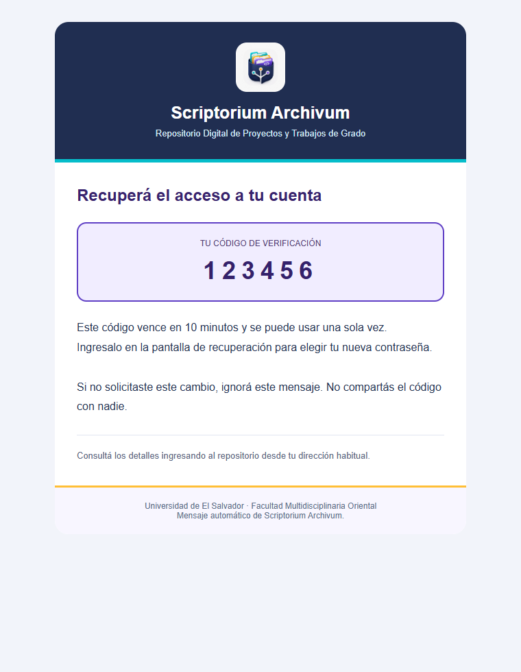

# Correos automáticos y docente a cargo

Los avisos explican lo que ocurrió con una cuenta o un trabajo. No son un chat ni conceden permisos adicionales. Biblioteca conserva la decisión de difusión y publicación.

## Qué se envía y a quién

| Acción realizada correctamente | Destinatarios |
| --- | --- |
| Crear una cuenta | La cuenta nueva recibe una bienvenida; el buzón del programa recibe el registro con nombre, correo y rol |
| Iniciar sesión con contraseña correcta | Buzón del programa, con nombre, correo, rol y hora de El Salvador |
| Cerrar sesión | Se registra en la bitácora, sin otro correo |
| Asignar o retirar el docente a cargo | Alumno y nuevo docente, si corresponde |
| Enviar un trabajo con PDF | Alumno, su docente asignado y las cuentas habilitadas de Biblioteca |
| Biblioteca corrige los datos del trabajo | Alumno/autores con cuenta y sus docentes asignados |
| Biblioteca reemplaza el PDF o asocia una referencia | Alumno/autores con cuenta y sus docentes asignados; se aclara que el nuevo ejemplar requiere revisión |
| Biblioteca guarda controles | Alumno/autores con cuenta y sus docentes asignados |
| Biblioteca registra una nueva decisión | Los mismos destinatarios; incluye resultado y motivo |
| Biblioteca publica | Los mismos destinatarios; incluye título, tipo y estado |
| Biblioteca retira una publicación | Los mismos destinatarios; incluye el motivo |
| Se adjunta material complementario | Alumno, docente y, si lo adjuntó el alumno, Biblioteca |
| Biblioteca habilita un archivo o agrega, habilita o elimina un enlace | Alumno/autores con cuenta y sus docentes asignados |

Los destinatarios se eligen entre las cuentas habilitadas con el rol correspondiente al registrar cada evento. Si un alumno todavía no tiene docente asignado, Biblioteca y el alumno reciben sus correos igualmente. No se avisa a docentes ajenos al trabajo. Cada destinatario recibe un mensaje separado.

Guardar controles conservando la decisión existente se anuncia como actualización de revisión, no como otra aprobación. Las consultas de fichas y las visitas a la página no generan correos. Una operación rechazada tampoco crea un aviso de éxito.

## Asignar el docente

1. Ingresá como Administrador.
2. Abrí **Roles** y buscá al alumno.
3. Su cuenta debe estar habilitada y tener rol **Estudiante**.
4. En **Docente a cargo**, elegí una cuenta habilitada de **Docente revisor**.
5. Pulsá **Guardar docente**.
6. Los próximos eventos del trabajo llegarán al docente elegido. La asignación se guarda en `usuarios.id_docente`.

Cambiar esa asignación no vuelve a enviar el historial anterior. La asignación tampoco permite al docente publicar ni sustituye la revisión académica que se defina para futuras entregas.

## Registro y entrega

- `bitacora`: conserva registro de cuenta, inicio/cierre de sesión, asignaciones y actuaciones sobre el trabajo.
- `notificaciones`: conserva los avisos de trabajos para sus destinatarios internos.
- `correos_eventos`: guarda los avisos pendientes, el destinatario, el estado, los intentos y la fecha de entrega al servidor de correo.
- **Roles → Consultar actividad**: últimas 200 actuaciones.
- **Roles → Actualizar correos**: últimos 100 correos operativos, solo para Administración.

La acción y su aviso se guardan en la misma transacción de PostgreSQL. Si falla SMTP, el trabajo sigue guardado y el aviso queda pendiente. Los reintentos son automáticos, con esperas crecientes y un máximo de cinco intentos. La cola permanece al reiniciar Docker. Las reservas abandonadas por una interrupción vuelven a procesarse al vencer un minuto.

**Enviado** significa que SMTP aceptó el mensaje: no garantiza que Gmail lo coloque en la bandeja principal. Revisá también Spam. Si SMTP acepta un mensaje justo antes de una interrupción y no alcanza a confirmarse en PostgreSQL, el reintento podría producir un duplicado. El sistema prioriza conservar el aviso.

Solo se registran accesos exitosos y cierres de sesión explícitos. No es un registro de todas las páginas visitadas ni de intentos fallidos de contraseña. Expirar una cookie o cerrar la ventana no equivale a pulsar «Salir».

## Diseño del correo y recuperación

La plantilla lleva el logo real del proyecto incrustado en el mensaje, los colores del repositorio, encabezado y pie institucional. Incluye una versión de texto para clientes que no muestran HTML. El código de recuperación se presenta en un recuadro, vence en diez minutos y solo puede usarse una vez.

Los códigos no se copian al buzón del programa, a la cola de avisos ni a la bitácora. La recuperación mantiene el código protegido en su tabla específica. La cola temporal de recuperación es independiente de la cola durable de avisos: si se interrumpe antes de enviarlo, solicitá un código nuevo una vez permitido el reenvío.



## Configuración privada

La configuración SMTP sigue en `backend/.env`, que no se sube a GitHub. La plantilla pública `.env.example` tiene campos vacíos.

- `SMTP_AVISOS`: buzón que recibe registros y accesos. Vacío usa el remitente `SMTP_FROM`.
- `SMTP_AVISOS_ACCESO=true`: avisa cada inicio de sesión correcto. `false` conserva el registro en PostgreSQL y evita esos correos; los registros nuevos siguen notificándose.
- `SMTP_HOST`, `SMTP_PORT`, `SMTP_TLS`, `SMTP_FROM`, `SMTP_USER`, `SMTP_PASSWORD`: transporte existente.

Con SMTP real, los destinatarios ficticios terminados en `.test` o `.invalid` aparecen como **Omitido**. No se intenta enviarlos a Internet. Con Mailpit sí se envían al buzón local para poder probarlos. Un acceso de una cuenta ficticia puede generar un aviso al buzón real del programa si los avisos de acceso están activos.

Después de cambiar el `.env`, desde `backend`:

```powershell
docker compose -p scriptorium-integracion up -d --no-deps api
```

## Instalar esta actualización en otra computadora

En una base nueva, `sql-init/12_avisos_y_docentes.sql` se ejecuta junto con los demás scripts al crear el volumen. En una base existente aplicá primero las migraciones anteriores y después, desde `backend`:

```powershell
$OutputEncoding = [Text.UTF8Encoding]::new($false)
Get-Content -LiteralPath '.\sql-init\12_avisos_y_docentes.sql' -Raw -Encoding utf8 |
    docker compose -p scriptorium-integracion exec -T postgres psql -X -v ON_ERROR_STOP=1 -U postgres -d scriptorium_archivum
if ($LASTEXITCODE -ne 0) { throw 'No se pudo aplicar la migración de avisos.' }
docker compose -p scriptorium-integracion up -d --build --no-deps api
```

No borres volúmenes para aplicar esta actualización. Los avisos comienzan con las operaciones nuevas; no se generan correos retrospectivos por todos los usuarios y trabajos existentes.

## Cómo comprobarlo

1. Registrá una cuenta nueva con un correo que puedas consultar. Debe llegar la bienvenida y el programa recibirá el registro.
2. Cerrá sesión e ingresá de nuevo. El programa recibe el aviso de acceso.
3. Administración asigna un docente al alumno. Ambos reciben la asignación.
4. El alumno envía un PDF. Él, el docente y Biblioteca reciben la confirmación.
5. Biblioteca revisa el trabajo y guarda sus controles. El alumno y el docente reciben la actualización; una nueva decisión incluye su motivo.
6. Al publicarlo, verificá su presencia en el catálogo y el aviso de publicación.
7. En Administración actualizá **Correos automáticos** para comprobar destinatarios y estado.
8. Pedí recuperación de contraseña. El código debe llegar únicamente a la cuenta que lo solicitó, dentro de la plantilla con logo.

La prueba local inicial cubrió el ciclo completo con Mailpit, comprobó que un rechazo no genera correos de éxito, verificó el logo CID y el código de un solo uso, y retiró su trabajo ficticio al terminar. La prueba de fallo controlado aparece identificada como **[PRUEBA] Fallo controlado**: usa un destinatario inválido a propósito para comprobar el límite de cinco intentos.
