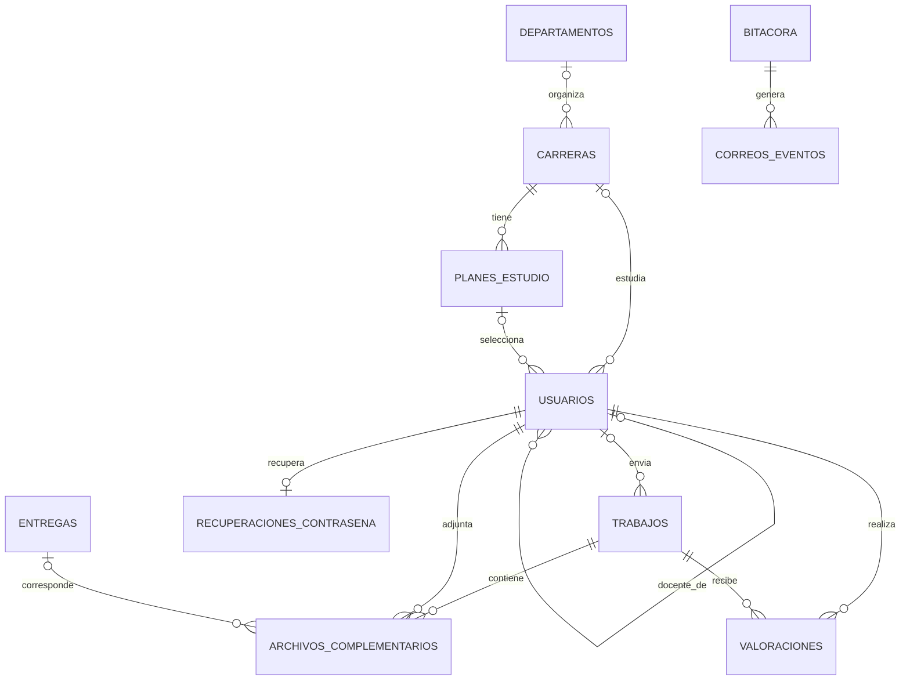

> **Documento histórico del 18/11/2026.** Conserva la comparación de ese día; los límites, roles, valoraciones y migraciones descritos no representan necesariamente la versión actual. Consulta el README, las migraciones vigentes y el informe de versiones corregidas para los cambios posteriores.

# Cambios del backend para actualizar el modelo y el diccionario de datos

Fecha de revisión: 18 de noviembre de 2026.

Comparación realizada entre `Scriptorium_archivum - backend para integracion.zip`, entregado originalmente, y el código actual de `scriptorium-archivum`. La última integración consultada en la copia Git es `936daf0`, que incorpora los cambios de la rama `frontend-benjamin-daniel`.

## 1. Resumen de la diferencia real

El ZIP original incluía los scripts `01_crear_base_de_datos.sql`, `02_crear_tablas.sql` y `03_funciones_procedimientos_triggers.sql`. Se compararon sus contenidos normalizando los saltos de línea y se comprobó que se conservaron.

Las ampliaciones del esquema están en las migraciones **04 a 12**. Se agregaron **seis tablas**, **diez columnas a usuarios** y una columna a cada una de estas tablas: `trabajos`, `carreras` y `tipos_trabajo`.

No corresponde rehacer el modelo desde cero ni presentar las tablas originales como nuevas. Deben incorporarse estas ampliaciones al modelo relacional, al DER, al diccionario y a la explicación del contrato de la API.

## 2. Columnas agregadas a tablas existentes

### public.usuarios

Se conservan su PK `id_usuario`, la FK a `personas`, la FK a `roles`, el correo y `hash_contrasena` del modelo original. El hash de contraseña ya existía: no es una columna nueva.

| Columna nueva | Tipo | Nulabilidad y valor inicial | Propósito y relación |
| --- | --- | --- | --- |
| nombre_mostrar | varchar(120) | Admite NULL | Nombre visible editable; si falta, la API muestra nombres y apellidos de personas |
| avatar | varchar(12) | NOT NULL, 'turquesa' | Avatar predefinido |
| tema | varchar(10) | NOT NULL, 'sistema' | Preferencia de tema |
| version_rol | integer | NOT NULL, 0 | Invalida sesiones cuando cambia el rol o el estado de la cuenta |
| foto_perfil | bytea | Admite NULL | Contenido binario de la foto; la API acepta JPG/PNG de hasta 2 MB |
| foto_tipo | varchar(30) | Admite NULL | Tipo MIME de la foto |
| foto_version | uuid | Admite NULL | Identificador para renovar la imagen en el navegador |
| id_carrera | integer | Admite NULL | FK a carreras.id_carrera |
| id_plan | integer | Admite NULL | FK a planes_estudio.id_plan |
| id_docente | integer | Admite NULL | FK a usuarios.id_usuario; relación autorreferente |

Las opciones de avatar, tema, formato de foto y pertenencia del plan a la carrera se validan en la aplicación. No deben dibujarse como restricciones CHECK o claves compuestas del esquema si no están declaradas en SQL.

### Otras tablas existentes

| Tabla | Columna nueva | Tipo y nulabilidad | Relación o propósito |
| --- | --- | --- | --- |
| trabajos | id_usuario_envio | integer, admite NULL | FK a usuarios.id_usuario; identifica la cuenta que envió el trabajo |
| carreras | id_departamento | integer, admite NULL | FK a departamentos.id_departamento |
| tipos_trabajo | activa | boolean NOT NULL DEFAULT true | Permite desactivar tipos para nuevas selecciones sin perder los trabajos existentes |

`carreras.activa` y `areas_tematicas.activa` ya existían. El promedio y la cantidad de valoraciones se calculan en consultas: no se añadieron columnas de promedio a trabajos.

## 3. Seis tablas nuevas

### 3.1 public.recuperaciones_contrasena — migración 05

| Columna | Definición |
| --- | --- |
| id_usuario | integer, PK y FK a usuarios.id_usuario, ON DELETE CASCADE |
| codigo_protegido | text, admite NULL |
| vence_en | timestamptz NOT NULL |
| ultimo_envio | timestamptz NOT NULL |
| inicio_ventana | timestamptz NOT NULL |
| envios_ventana | integer NOT NULL DEFAULT 1 |
| intentos | integer NOT NULL DEFAULT 0 |

Una cuenta puede tener cero o un registro de recuperación. Ese registro se actualiza para nuevas solicitudes; no es una fila por cada código histórico. El código se protege con Data Protection; no se guarda como texto legible en esta tabla ni se copia a la bitácora o a la cola de avisos.

### 3.2 public.archivos_complementarios — migración 06

| Columna | Definición |
| --- | --- |
| id_archivo | bigint, identidad y PK |
| id_trabajo | integer NOT NULL, FK a trabajos |
| id_usuario | integer NOT NULL, FK a usuarios; cuenta que adjuntó el archivo |
| id_entrega | integer, admite NULL, FK a entregas |
| nombre | varchar(255) NOT NULL |
| clave | varchar(50) NOT NULL UNIQUE |
| descripcion | varchar(1500) NOT NULL |
| tamano_bytes | bigint NOT NULL, CHECK > 0 y <= 26214400 |
| habilitado | boolean NOT NULL DEFAULT false |
| fecha_registro | timestamptz NOT NULL DEFAULT now() |

Se usa para anexos Word, Excel, ZIP, PDF o código/texto. El contenido se guarda en `backend/storage/trabajos`; PostgreSQL guarda los metadatos y la clave. El PDF principal sigue usando `recursos_digitales` y `entregas`, como en el diseño original.

### 3.3 public.departamentos — migración 07

| Columna | Definición |
| --- | --- |
| id_departamento | integer, identidad y PK |
| nombre | varchar(100) NOT NULL UNIQUE |
| activa | boolean NOT NULL DEFAULT true |

La carga incorpora una oferta inicial de 41 carreras agrupadas en nueve departamentos organizativos. Sus identificadores FMO-* y agrupaciones son internos; la validación institucional de nombres y agrupaciones debe documentarse por separado.

`departamentos` no reemplaza `areas_tematicas`: el departamento organiza carreras; las áreas temáticas clasifican trabajos y conservan su relación muchos a muchos mediante `trabajos_areas`.

En instalaciones intermedias se utilizó el nombre `areas_academicas`. Las migraciones 07 y 09 contemplan renombrarlo a `departamentos`, y `id_area_academica` a `id_departamento`, sin duplicar ese catálogo. No son dos entidades que deban aparecer juntas en el DER final.

### 3.4 public.planes_estudio — migración 08

| Columna | Definición |
| --- | --- |
| id_plan | integer, identidad y PK |
| id_carrera | integer NOT NULL, FK a carreras |
| nombre | varchar(120) NOT NULL |
| documento_url | text, admite NULL |
| activa | boolean NOT NULL DEFAULT true |

Restricción UNIQUE sobre `(id_carrera, nombre)`. Representa carrera y versión del plan, por ejemplo «Pénsum 1998». No almacena materias ni ciclos del pénsum. La API comprueba que el plan elegido corresponda a la carrera del usuario.

### 3.5 public.valoraciones — migración 10

| Columna | Definición |
| --- | --- |
| id_usuario | integer NOT NULL, FK a usuarios |
| id_trabajo | integer NOT NULL, FK a trabajos |
| estrellas | smallint NOT NULL, CHECK BETWEEN 1 AND 5 |
| fecha_registro | timestamptz NOT NULL DEFAULT now() |
| fecha_actualizacion | timestamptz NOT NULL DEFAULT now() |

PK compuesta `(id_usuario, id_trabajo)`: una valoración por cuenta y trabajo, que puede actualizarse o retirarse. El promedio puede ser decimal, aunque cada voto individual sea entero. Esta tabla resuelve la relación muchos a muchos entre cuentas y trabajos valorados.

### 3.6 public.correos_eventos — migración 12

| Columna | Definición |
| --- | --- |
| id_correo | bigint, identidad GENERATED ALWAYS y PK |
| id_evento | integer NOT NULL, FK a bitacora.id_evento |
| destino | varchar(254) NOT NULL |
| asunto | varchar(180) NOT NULL |
| titulo | varchar(180) NOT NULL |
| mensaje | text NOT NULL |
| estado | varchar(15) NOT NULL DEFAULT 'Pendiente'; CHECK Pendiente/Enviando/Enviado/Fallido/Omitido |
| intentos | integer NOT NULL DEFAULT 0; CHECK BETWEEN 0 AND 5 |
| creado_en | timestamptz NOT NULL DEFAULT now() |
| proximo_intento | timestamptz NOT NULL DEFAULT now() |
| bloqueado_hasta | timestamptz, admite NULL |
| enviado_en | timestamptz, admite NULL |
| error_tipo | varchar(100), admite NULL |

UNIQUE `(id_evento, destino)`. Una actuación de bitácora puede generar varios correos, uno por destinatario. La cola se guarda en PostgreSQL y se procesa en segundo plano con un máximo de cinco intentos. No contiene contraseñas SMTP ni códigos de recuperación.

`notificaciones` y `bitacora` ya estaban en el modelo original. La nueva lógica las utiliza; la tabla nueva de entrega de correo es `correos_eventos`.

## 4. Cardinalidades que deben reflejarse

La columna «por registro hijo» indica su participación mínima y máxima. Que una FK permita NULL significa que la relación es opcional en el esquema, aunque un formulario la exija para una operación concreta.

| Relación padre → hijo | Hijos por padre | Padres por registro hijo |
| --- | --- | --- |
| departamentos → carreras | 0..N | 0..1 departamento por carrera |
| carreras → planes_estudio | 0..N | Exactamente 1 carrera por plan |
| carreras → usuarios | 0..N | 0..1 carrera por cuenta |
| planes_estudio → usuarios | 0..N | 0..1 plan por cuenta |
| usuarios (docente) → usuarios (alumno) | 0..N | 0..1 docente por alumno |
| usuarios → trabajos, mediante id_usuario_envio | 0..N | 0..1 cuenta remitente por trabajo |
| usuarios → recuperaciones_contrasena | 0..1 | Exactamente 1 cuenta por registro de recuperación |
| trabajos → archivos_complementarios | 0..N | Exactamente 1 trabajo por archivo |
| usuarios → archivos_complementarios | 0..N | Exactamente 1 cuenta que adjuntó cada archivo |
| entregas → archivos_complementarios | 0..N | 0..1 entrega por archivo |
| usuarios → valoraciones | 0..N | Exactamente 1 cuenta por voto |
| trabajos → valoraciones | 0..N | Exactamente 1 trabajo por voto |
| bitacora → correos_eventos | 0..N | Exactamente 1 evento por correo |

La relación autorreferente permite varios estudiantes por docente y un único docente asignado por estudiante en esta versión. No se creó una tabla independiente de docentes: son cuentas de usuarios con rol `Docente revisor`. La FK por sí sola no limita roles; la API exige que Administración asigne un docente habilitado a un Estudiante habilitado.

La relación original `personas → usuarios` conserva la unicidad de `usuarios.id_persona`. No se cambió esa cardinalidad. Las autorías y múltiples áreas por trabajo también conservan su estructura original.

Este es un diagrama de las ampliaciones, no el DER completo del repositorio.

## 5. Qué cambió en API y comportamiento

| Módulo | Rutas o cambios que deben explicarse |
| --- | --- |
| Cuentas | POST /api/auth/registro; GET /api/auth/me; PUT /api/auth/perfil; PUT /api/auth/contrasena; se mantienen login/logout por cookie |
| Fotos | POST, GET y DELETE /api/auth/foto; imagen binaria en PostgreSQL |
| Recuperación | POST /api/auth/recuperacion/solicitar y /confirmar; código protegido, vigencia de diez minutos y un uso |
| Envíos | GET/POST /api/mis-envios; autor tomado de la cuenta; carrera comprobada contra el perfil en PostgreSQL; PDF válido de hasta 25 MB |
| Roles | GET /api/admin/roles; PUT /{id}; PUT /{id}/estado; POST /{id}/recuperacion; GET /actividad |
| Docente a cargo | PUT /api/admin/roles/{id}/docente con id_docente o null; docentes habilitados incluidos al listar roles |
| Seguimiento de correo | GET /api/admin/roles/correos; solo Administración |
| Oferta académica | GET /api/oferta-academica; departamentos, carreras y planes para la selección dependiente |
| Catálogos administrativos | GET/POST /api/admin/catalogos/{tipo}; PUT /api/admin/catalogos/{tipo}/{id}; carreras, departamentos, áreas temáticas, planes y tipos de trabajo |
| Valoraciones | GET/PUT/DELETE /api/trabajos/{id}/valoracion; requiere sesión y ficha pública accesible |
| Anexos | GET/POST /api/trabajos/{id}/archivos; GET/PATCH /{archivo}; Biblioteca habilita difusión |
| Catálogo público | Agrega promedio/cantidad de valoraciones, orden por valoración y filtro por departamento; Angular pagina la lista recibida |
| Biblioteca | Guardado de metadatos por IDs; revisión del ejemplar exacto; decisión nueva diferenciada de decisión conservada; avisos por cambios en el trabajo y sus anexos |

Los cinco roles utilizados son Lector, Estudiante, Biblioteca, Docente revisor y Administrador. La interfaz llama «Bibliotecario» al rol cuyo valor interno es `Biblioteca`. El registro con carrera crea Estudiante; sin carrera crea Lector. No se permite elegir roles privilegiados desde el registro público.

La asignación del docente habilita los avisos correspondientes, no le concede permisos de publicación ni implementa por sí sola un flujo de evaluación académica. Biblioteca conserva la decisión de difusión.

El cambio de PDF no conserva automáticamente las verificaciones, autorizaciones ni decisión favorable del ejemplar anterior. Las fechas de constancia y depósito se tratan como fechas institucionales; las comparaciones de vigencia y presentación usan El Salvador cuando corresponde. Las marcas de tiempo continúan siendo timestamptz.

## 6. Docker, archivos y correo

- Se conserva el backend ASP.NET Core y PostgreSQL. El proxy de Angular usa rutas relativas `/api` y la sesión se mantiene por cookie.
- Compose incorpora/configura API, PostgreSQL, pgAdmin y Mailpit. Para correo real puede usar SMTP; sus credenciales permanecen en `.env` privado.
- Los datos de PostgreSQL y las claves de Data Protection se conservan en volúmenes. El segundo volumen es importante para las cookies y la protección de códigos.
- PDF y anexos se almacenan físicamente en `backend/storage/trabajos`; no deben incluirse en GitHub. Las fotos de perfil sí se guardan como bytea en usuarios.
- Los avisos de registro, acceso, envío, revisión, publicación, retiro y material complementario se generan con destinatarios según el evento. Administración asigna al docente del estudiante.
- Los correos usan el logo incrustado y plantilla HTML con alternativa de texto. No se envían contraseñas; los códigos de recuperación se entregan únicamente a la cuenta solicitante.
- El SMTP se procesa fuera de la petición del usuario: una falla de entrega no borra un trabajo ya guardado. La cola durable de avisos no es la misma cola temporal que entrega códigos de recuperación.
- Se excluyen de GitHub los `.env` privados, las claves, los respaldos y los documentos subidos por usuarios. `.env.example` solo contiene la plantilla de configuración.

## 7. Documentación afectada por las ampliaciones

1. **DER:** agregar las seis entidades, sus claves y las relaciones de la sección 4, incluyendo la relación recursiva de docente/alumno.
2. **Modelo relacional:** incorporar las columnas nuevas y las PK/FK/UNIQUE/CHECK descritas, manteniendo las claves del modelo original.
3. **Diccionario:** registrar tipos, nulabilidad, valores por defecto, finalidad y reglas de negocio. Diferenciar validación de API de restricción física de PostgreSQL.
4. **Roles y permisos:** documentar las cinco funciones, el alta Lector/Estudiante y la asignación del docente solo por Administración.
5. **Contrato API:** incorporar las rutas nuevas y los datos asociados; separar id_usuario_envio de los autores que se modelan con participaciones.
6. **Flujos:** documentar envío, revisión, sustitución de ejemplar, publicación, avisos y recuperación de contraseña.
7. **Instalación y actualización:** mantener los scripts originales y aplicar las migraciones 04–12 en orden, sin borrar la base ni los PDF existentes.

Los PDF de DER, modelo relacional y diccionario incluidos originalmente no se regeneraron para estas ampliaciones. No basta con conservar esos PDF sin actualizarlos: deben contrastarse con estas migraciones.

Las migraciones SQL son la referencia del esquema. El diccionario debe reflejar lo implementado, sin atribuir a PostgreSQL reglas que solo valida la API. No se requiere cambiar el esquema únicamente para redactar esta explicación.

## Referencias dentro del proyecto

- `backend/sql-init/04_perfil_usuarios.sql` a `12_avisos_y_docentes.sql`.
- `backend/integracion/INTEGRACION.md`: contrato y rutas.
- `docs/AVISOS-CORREO.md`: destinatarios, asignaciones y entrega de correo.
- `docs/INSTALACION-PASO-A-PASO.md`: instalación y GitHub.
- `docs/AUDITORIA-INTEGRACION.md`: comprobaciones de integración realizadas anteriormente.
